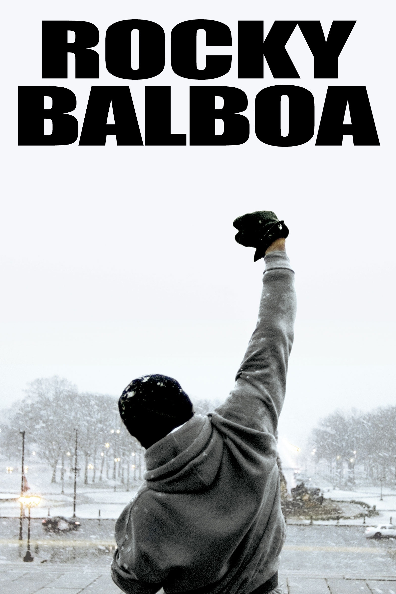

---

# 📍 Sypnosis
In working-class Philadelphia, small-time club boxer and debt collector Rocky Balboa gets an unexpected chance at fame when current World Heavyweight Champion Apollo Creed decides to select a local underdog for an upcoming title match as a promotional gimmick. Recognizing the fight as a fleeting opportunity to break out of his bleak circumstances, Rocky commits to an intense training regimen under the guidance of former bantamweight fighter Mickey Goldmill. Alongside his budding romance with shy pet store clerk Adrian, Rocky prepares for the bout knowing that victory is unlikely, choosing instead to focus on staying on his feet for all fifteen rounds to prove his personal resilience and self-worth.
> ADRIAAAAAN

---

# 🍿 Movie Details
* **Written by and starring Sylvester Stallone alongside Talia Shire, Carl Weathers, Burgess Meredith, and Burt Young, Rocky is a 1976 sports drama and romance directed by John G. Avildsen with a 119-minute runtime. The film follows Rocky Balboa, an uneducated club boxer and debt collector living in Philadelphia, who receives a once-in-a-lifetime opportunity to fight the undefeated World Heavyweight Champion, Apollo Creed. Guided by his crusty trainer Mickey and supported by his love interest Adrian, Rocky fights not to win the title, but to push himself to his absolute limits and prove his own self-worth. Rocky went on to earn ten Academy Award nominations and won three, including Best Picture and Best Director.**

---

# 🐎 Main Character
Rocky Balboa, played by Sylvester Stallone, is a kind-hearted, working-class club fighter from South Philadelphia. Often underestimated due to his slow speech and unpolished style, Rocky is defined by his humble nature, iron chin, and relentless heart. When given an unexpected, once-in-a-lifetime shot at the Heavyweight Championship, he sets out not necessarily to win, but to prove to himself and the world that he can go the distance.

---
